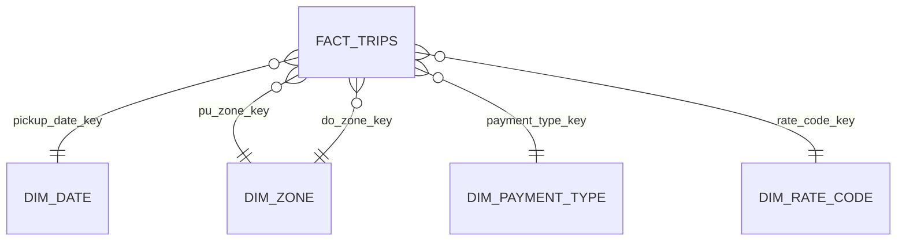

# Gold Model

## Grain
- fact_trips: one row per trip
- agg_daily: per day | agg_hourly: per day and hour | agg_zone_monthly: per month and pickup zone

## Decisions
- Natural keys for small dimensions, because ...
- Unknown member (-1) so facts never point at nothing
- tip_pct only for credit card trips, because cash tips are not recorded
- Speed is NULL for trips under 1 minute, because ...
- Day of week follows ISO (Monday = 1)

## Findings from my data
- Top pickup zones: ...
- Tip percentage by hour: ...
- Weekday vs weekend: ...
- Anything surprising or suspicious: ...

## Known limitations
- tip_pct and speed are not capped, so extreme values exist
- Payment and rate code names come from the TLC data dictionary and should be re-checked periodically

## Findings from my data (Jan to Mar 2025, 10,412,561 trips)
- Top pickup zones by trips: Midtown Center (487,180), Upper East Side South
  (473,417), Upper East Side North (437,129). JFK Airport is 4th by trips
  (398,771) but 1st by revenue (about $32.5M) because airport fares are higher.
- Weekdays: 7,299,884 trips, average total $27.65, 3.19 miles.
  Weekends: 3,112,677 trips, average total $26.31, 3.28 miles.
- Card tips are roughly 23 to 28% of the base fare, lowest around 5 to 6 am
  and highest in the late afternoon and evening. The weighted figure is: ...
- Manhattan to Manhattan is about 84% of all trips. Queens to Manhattan
  averages $79.80, consistent with airport trips.
- Trip counts in the daily aggregate reconcile exactly with Silver.